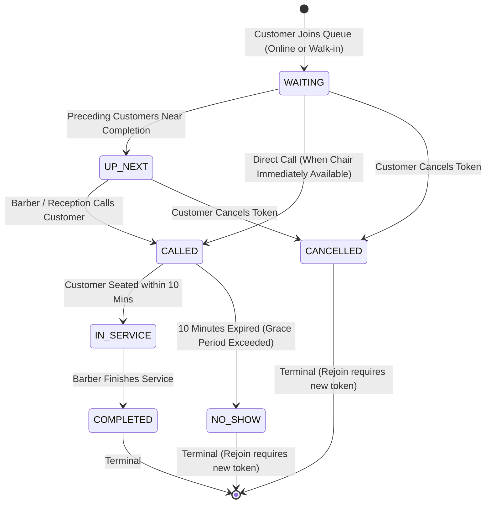
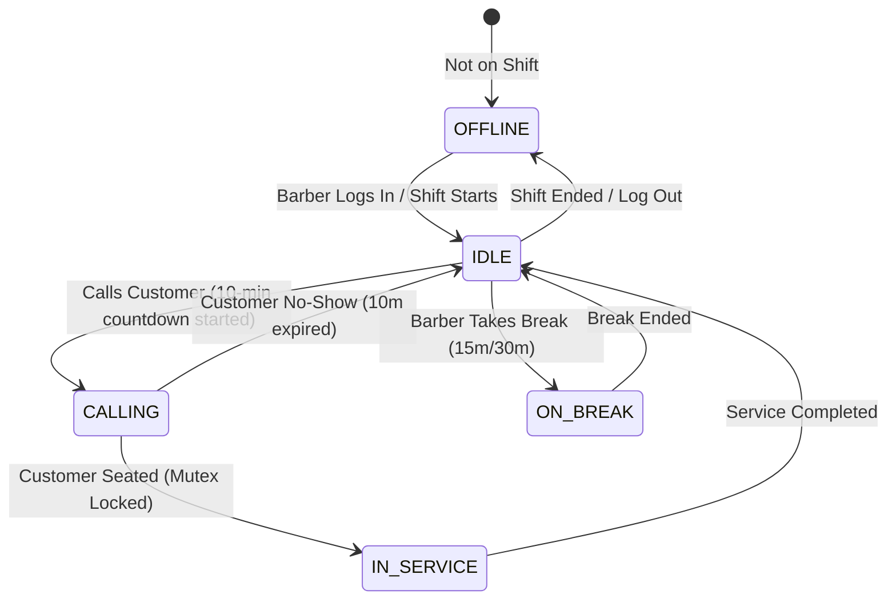
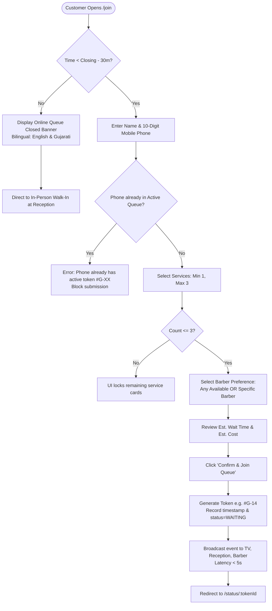
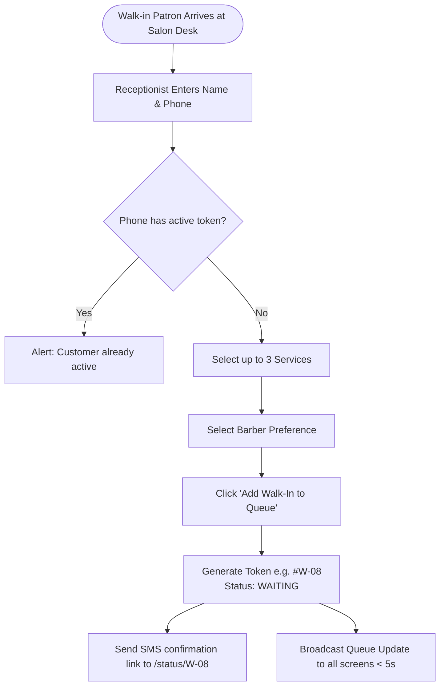
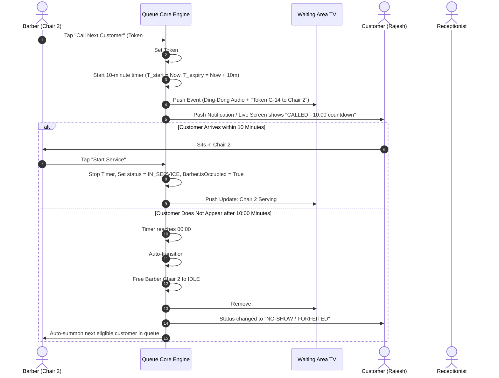
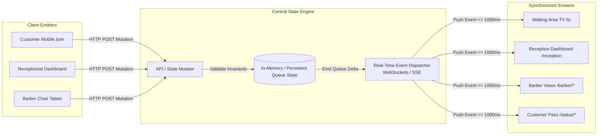

# Salon Queue Management System — Flows, Business Rules, Validation & Test Cases
**Document ID:** `DOC-03-FLOWS-RULES`  
**Version:** 1.0.0  
**Design Palette:** Charcoal (`#1F2937`) & Metallic Gold (`#D4A017`)  
**Bilingual Support:** Full English (en) & Gujarati (ગુજરાતી - gu)

---

## 1. System Invariants & Non-Negotiable Business Rules

The system is governed by ten core architectural and operational invariants. Every state mutation must satisfy these invariants before being committed.

```
+----------------------------------------------------------------------------------------------------+
| CORE INVARIANTS SUMMARY MATRIX                                                                     |
+----+----------------------------------+------------------------------------------------------------+
| #  | INVARIANT NAME                   | STRICT SPECIFICATION                                       |
+----+----------------------------------+------------------------------------------------------------+
| 01 | First-Come, First-Served (FCFS)  | Priority is strictly chronological by creation timestamp.   |
| 02 | Barber Preference Arbitration    | "Any Available" takes first free chair; Specific waits.    |
| 03 | Three-Service Maximum            | Exactly 1 to 3 services permitted per booking token.       |
| 04 | One Active Token per Phone       | A phone number can hold only 1 non-terminal token.         |
| 05 | Single-Occupancy Barber Chairs   | 1 customer per barber station at a time (Mutex Lock).      |
| 06 | 10-Minute No-Show Rule           | Unseated called customers forfeit spot after 10:00 mins.   |
| 07 | New Token on Rejoining           | Forfeited tokens are terminal; customer must rejoin anew.  |
| 08 | 30-Min Online Closing Cutoff     | Online intake locks 30m before salon closing time.         |
| 09 | Walk-In Reception Override       | Receptionist can register physical walk-ins past cutoff.   |
| 10 | Sub-5-Second Synchronization     | All screens receive state updates in ≤ 5000 ms.            |
+----+----------------------------------+------------------------------------------------------------+
```

### Detailed Invariant Definitions

#### Invariant 01: First-Come, First-Served (FCFS) Queue Prioritization
Queue order is determined strictly by the timestamp `createdAt` when the token is generated. No customer can jump ahead of an earlier customer who requested the same barber resource, maintaining complete transparency and perceived fairness.

#### Invariant 02: Barber Preference Arbitration
Customers may select either:
- **Any Available Barber (`કોઈપણ ઉપલબ્ધ હેર સ્ટાઈલિશ`):** Customer is assigned to whichever active barber chair becomes free first.
- **Specific Barber (`અમિત કુમાર` / `વિક્રમ દવે`):** Customer is assigned exclusively to their selected barber's queue lane. If another barber chair becomes idle, the customer remains waiting until their selected barber is ready, without penalizing or blocking "Any Available" customers behind them.

#### Invariant 03: Three-Service Maximum Per Booking
A customer can select a minimum of 1 and a **maximum of 3 services** per queue token.
- Total token duration = $\sum_{i=1}^{k} \text{duration}(S_i)$ where $k \le 3$.
- Total token price = $\sum_{i=1}^{k} \text{price}(S_i)$.
- Adding a 4th service is disallowed by UI selection lock and server validation reject (`HTTP 422`).

#### Invariant 04: One Active Position Per Phone Number
A phone number cannot possess more than one non-terminal token simultaneously.
- Non-terminal statuses: `WAITING`, `UP_NEXT`, `CALLED`, `IN_SERVICE`.
- Terminal statuses: `COMPLETED`, `NO_SHOW`, `CANCELLED`.
- A customer whose token is in a terminal status may join again, but will receive a new token number.

#### Invariant 05: Single-Occupancy Barber Chairs (Mutex Lock)
At any point in time, a barber chair can seat **at most one customer**.
- Transitioning a customer to `IN_SERVICE` locks the barber's `isOccupied` flag to `true`.
- The system rejects any attempt to assign a second customer to an occupied barber chair.

#### Invariant 06: 10-Minute No-Show Escalation Rule
When a customer's token is transitioned to `CALLED`:
- An automated countdown timer of **exactly 10 minutes (600 seconds)** initiates.
- If the customer does not report and transition to `IN_SERVICE` before the timer reaches `00:00`, the system automatically marks the token as `NO_SHOW`.
- The barber chair is immediately released back to `IDLE` and the next eligible token is summoned.

#### Invariant 07: New Token on Rejoining (Zero Token Resurrection)
Once a token enters a terminal state (`CANCELLED` or `NO_SHOW`), it is permanently immutable. It cannot be "reactivated" or restored to its previous position. A client returning to the salon must register through the standard intake flow and receive a newly generated token placed at the tail of the queue.

#### Invariant 08: 30-Minute Closing Cutoff for Online Joining
If $\text{CurrentTime} \ge (\text{SalonClosingTime} - 30\text{ minutes})$, the online `/join` screen locks. It renders an informative notice in English and Gujarati explaining that online bookings have ceased for the day.

#### Invariant 09: Walk-In Reception Override
While online intake is disabled 30 minutes before closing, the receptionist retains administrative capability on the **Reception Dashboard** to register physical walk-in customers if actual chair availability and remaining service durations allow completion before closing time.

#### Invariant 10: Sub-5-Second Synchronization SLA
All connected clients (Customer Mobile, Reception Dashboard, Barber Tablet, Waiting Area TV) must reflect any queue mutation within **less than 5 seconds** ($\le 5000\text{ms}$). Updates are propagated via Server-Sent Events (SSE) or WebSockets, with a 4-second polling fallback.

---

## 2. System State Machines & Entity Lifecycles

### 2.1 Token State Machine


### 2.2 Barber State Machine


---

## 3. End-to-End User Journey Flows

### 3.1 Flow A: Online Customer Queue Registration


### 3.2 Flow B: Receptionist Walk-In Intake


### 3.3 Flow C: 10-Minute No-Show Escalation Ladder


### 3.4 Flow D: Real-Time Synchronization Architecture (< 5s Latency)


---

## 4. Input Validation & Error Handling Matrix

| Field | Rule & Constraint | Regex / Boundary | Error Message (English) | Error Message (Gujarati - ગુજરાતી) |
| :--- | :--- | :--- | :--- | :--- |
| **Customer Name** | Required, letters & spaces only | `^[a-zA-Z\s\u0A80-\u0AFF]{2,50}$` | "Please enter a valid name (2-50 characters)." | "કૃપા કરીને માન્ય નામ દાખલ કરો (૨-૫૦ અક્ષરો)." |
| **Phone Number** | Required, valid 10-digit Indian mobile | `^[6-9]\d{9}$` | "Enter a valid 10-digit mobile number." | "માન્ય ૧૦ અંકોનો મોબાઈલ નંબર દાખલ કરો." |
| **Duplicate Phone** | Exactly 1 active token permitted | Active status lookup | "This phone number already has an active token in queue." | "આ ફોન નંબર પર પહેલેથી જ કતારમાં એક્ટિવ ટોકન છે." |
| **Service Selection** | Min 1, Max 3 services | $1 \le \text{count} \le 3$ | "Please select between 1 and 3 services." | "કૃપા કરીને ૧ થી ૩ સેવાઓ પસંદ કરો." |
| **Barber Preference** | Must be valid ID or "ANY" | Exists in Active Barbers | "Selected barber is currently unavailable." | "પસંદ કરેલા હેર સ્ટાઈલિશ હાલમાં ઉપલબ્ધ નથી." |
| **Online Cutoff** | Current time < Closing - 30m | System clock check | "Online queue is closed (30 mins before closing). Visit reception." | "ઓનલાઇન કતાર બંધ છે (બંધ થવાના ૩૦ મિનિટ પહેલાં). રૂબરૂ મળો." |
| **Chair Mutex** | Barber cannot be occupied | `barber.isOccupied == false` | "Barber chair is currently occupied by another customer." | "આ હેર સ્ટાઈલિશ હાલમાં અન્ય ગ્રાહકની સેવામાં છે." |

---

## 5. Comprehensive Quality Assurance Test Suite

The following 10 core test cases rigorously validate the business rules, invariants, edge cases, and performance constraints.

---

### Test Case TC-01: Strict Enforce of 3-Service Maximum
- **Objective:** Verify that a customer cannot select more than 3 services during queue entry.
- **Pre-conditions:** System is online, 5 services available in catalog.
- **Steps:**
  1. Open `/join`.
  2. Enter valid Name ("Rajesh") and valid Phone ("9825012345").
  3. Click and select Service 1 (Haircut), Service 2 (Beard Trim), Service 3 (Face Scrub).
  4. Attempt to click Service 4 (Hair Spa).
- **Expected Result:** Service 4 checkbox remains unselected; UI visually disables remaining services and displays toast notification: *"Maximum 3 services allowed per booking"*. If payload with 4 services is directly sent via API, backend returns `HTTP 422 Unprocessable Entity`.
- **Pass/Fail Criteria:** PASS if 4th service cannot be added; FAIL if payload with 4 services is accepted.

---

### Test Case TC-02: Prevent Duplicate Active Tokens for Single Phone Number
- **Objective:** Ensure a phone number cannot hold more than one active position.
- **Pre-conditions:** Token `#G-10` exists in state `WAITING` with phone `"9876543210"`.
- **Steps:**
  1. Open `/join`.
  2. Enter Name ("Rajesh Patel") and Mobile `"9876543210"`.
  3. Select 1 service and submit.
- **Expected Result:** Submission is rejected. Screen displays error banner: *"This phone number already has an active queue token (#G-10). You cannot register twice simultaneously."*
- **Pass/Fail Criteria:** PASS if duplicate submission is blocked and existing token referenced; FAIL if new token is generated.

---

### Test Case TC-03: First-Come, First-Served (FCFS) Ordering with "Any Available"
- **Objective:** Verify that unassigned customers are summoned in strict chronological order when a barber becomes free.
- **Pre-conditions:** 
  - Token `#G-01` created at 10:00 AM (Pref: Any).
  - Token `#G-02` created at 10:05 AM (Pref: Any).
  - Barber Amit finishes service and clicks "Call Next".
- **Steps:**
  1. Barber Amit clicks `[ Complete & Call Next ]` on Chair 1.
- **Expected Result:** System selects `#G-01` (earliest timestamp). `#G-01` transitions to `CALLED`, assigned to Chair 1. `#G-02` transitions to `UP_NEXT`.
- **Pass/Fail Criteria:** PASS if `#G-01` is selected before `#G-02`; FAIL if order is inverted.

---

### Test Case TC-04: Barber Preference Routing Isolation
- **Objective:** Verify that a customer waiting for a specific barber does not block general customers when another barber becomes free.
- **Pre-conditions:**
  - Token `#G-05` created at 11:00 AM (Pref: Barber Vikram).
  - Token `#G-06` created at 11:02 AM (Pref: Any Available).
  - Barber Amit (Chair 1) becomes free, while Barber Vikram (Chair 2) is busy for another 30 mins.
- **Steps:**
  1. Barber Amit requests next customer.
- **Expected Result:** Since `#G-05` explicitly requested Vikram, Amit cannot seat `#G-05`. The system routes `#G-06` ("Any") to Barber Amit. `#G-05` remains at the front of Vikram's queue without losing timestamp priority.
- **Pass/Fail Criteria:** PASS if `#G-06` is served by Amit while `#G-05` remains reserved for Vikram; FAIL if `#G-05` is erroneously assigned to Amit or `#G-06` is blocked.

---

### Test Case TC-05: Automated 10-Minute No-Show Escalation
- **Objective:** Verify that calling a customer starts a 10-minute timer and expires if unseated.
- **Pre-conditions:** Token `#G-14` is in `UP_NEXT`. Barber Chair 1 calls `#G-14`.
- **Steps:**
  1. Receptionist or Barber clicks `[ Call Customer ]`.
  2. Verify token state transitions to `CALLED` and countdown timer displays `10:00`.
  3. Simulate/wait 10 minutes (600 seconds) without customer reporting.
- **Expected Result:**
  - At $T = 10\text{m } 01\text{s}$, token `#G-14` transitions to `NO_SHOW`.
  - Chair 1 state resets to `IDLE`.
  - Waiting Area TV and Customer Status screens update to show forfeited status.
- **Pass/Fail Criteria:** PASS if token automatically marks as `NO_SHOW` exactly after 10 minutes; FAIL if token remains in `CALLED` indefinitely.

---

### Test Case TC-06: New Token Issuance on Rejoining After No-Show/Cancellation
- **Objective:** Ensure a cancelled or no-show customer cannot reclaim their old position and must join anew.
- **Pre-conditions:** Customer with phone `"9123456789"` held token `#G-04`, which became `NO_SHOW`.
- **Steps:**
  1. Customer visits `/join` with phone `"9123456789"`.
  2. Selects 1 service and clicks `[ Confirm & Join ]`.
- **Expected Result:** System allows submission because `#G-04` is in terminal state `NO_SHOW`. System generates a brand new token (e.g., `#G-18`), placed at the very end of the current queue. Old token `#G-04` remains untouched in history.
- **Pass/Fail Criteria:** PASS if brand new token is issued at queue tail; FAIL if old token `#G-04` is reactivated or restored to previous queue spot.

---

### Test Case TC-07: Online Joining Cutoff 30 Minutes Before Closing
- **Objective:** Validate that online queue intake shuts down precisely 30 minutes before closing.
- **Pre-conditions:** Salon closing time is set to `21:00` (09:00 PM). System time advances to `20:30` (08:30 PM).
- **Steps:**
  1. Customer navigates to `/join` at `20:30:05 PM`.
- **Expected Result:**
  - The form is disabled or hidden.
  - Informative banner is displayed in English and Gujarati:
    *"Online queue registration has closed for today (30 minutes prior to salon closing). Walk-ins may visit the front desk."*
  - Direct API `POST /api/queue/join` returns `HTTP 403 Forbidden` with error code `ONLINE_QUEUE_CLOSED`.
- **Pass/Fail Criteria:** PASS if online registration is locked; FAIL if customer can still obtain a token online at 20:31 PM.

---

### Test Case TC-08: Reception Walk-In Override After Online Cutoff
- **Objective:** Verify that reception can register a physical walk-in even after online intake is closed.
- **Pre-conditions:** System time is `20:35 PM` (past online cutoff of 20:30 PM).
- **Steps:**
  1. Receptionist opens `/reception`.
  2. Enters walk-in client Name ("Dilip Patel"), Phone `"9988776655"`, selects 1 service (15-min Beard Trim).
  3. Clicks `[ + Add Walk-in to Queue ]`.
- **Expected Result:** Walk-in token `#W-09` is successfully created, inserted into active queue, and visible immediately on the Waiting Area TV screen.
- **Pass/Fail Criteria:** PASS if walk-in token is created successfully; FAIL if receptionist is blocked by the online 30-min closing rule.

---

### Test Case TC-09: Single-Occupancy Barber Mutex Lock
- **Objective:** Ensure a barber chair cannot have two customers `IN_SERVICE` at the same time.
- **Pre-conditions:** Barber Amit (Chair 1) is currently `IN_SERVICE` with token `#G-11`.
- **Steps:**
  1. Receptionist attempts to seat token `#G-12` in Chair 1 via manual override without completing `#G-11`.
- **Expected Result:** Action is rejected with error modal: *"Chair 1 is currently occupied by #G-11. Please complete or transfer the active service first."*
- **Pass/Fail Criteria:** PASS if assignment is blocked; FAIL if both `#G-11` and `#G-12` are marked `IN_SERVICE` with the same barber simultaneously.

---

### Test Case TC-10: Real-Time Synchronization Latency (≤ 5 Seconds)
- **Objective:** Measure latency from queue mutation to display update across all client screens.
- **Pre-conditions:** Waiting Area TV (`/tv`), Reception (`/reception`), and Customer Status (`/status/G-15`) are open on separate devices/browsers.
- **Steps:**
  1. Barber completes service on Chair 2, triggering next token `#G-15` call at timestamp $T_0$.
  2. Measure timestamp $T_1$ when TV chime plays and token `#G-15` appears under "Now Serving".
  3. Measure timestamp $T_2$ when Customer Status screen switches to "Called".
- **Expected Result:** Latency $\Delta T = (T_1 - T_0) \le 5000\text{ms}$ and $(T_2 - T_0) \le 5000\text{ms}$. Both screens update without requiring manual page reload.
- **Pass/Fail Criteria:** PASS if all displays synchronize in under 5.0 seconds; FAIL if delay exceeds 5.0 seconds or requires page refresh.

---

### Test Case TC-11: Gujarati Language Toggle & State Preservation
- **Objective:** Verify that toggling between English and Gujarati updates all labels instantly without resetting entered input values.
- **Pre-conditions:** Customer is on `/join`, has entered name "Hitesh" and selected 2 services.
- **Steps:**
  1. Click language toggle pill `[ ગુજરાતી ]`.
- **Expected Result:**
  - Page headings, field labels, service names, and button texts immediately render in Gujarati.
  - The entered text ("Hitesh") and selected service checkboxes remain selected and intact.
- **Pass/Fail Criteria:** PASS if translation occurs without form data loss; FAIL if inputs are wiped or Gujarati text fails to render.
